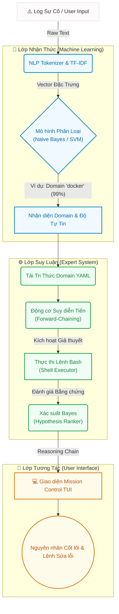
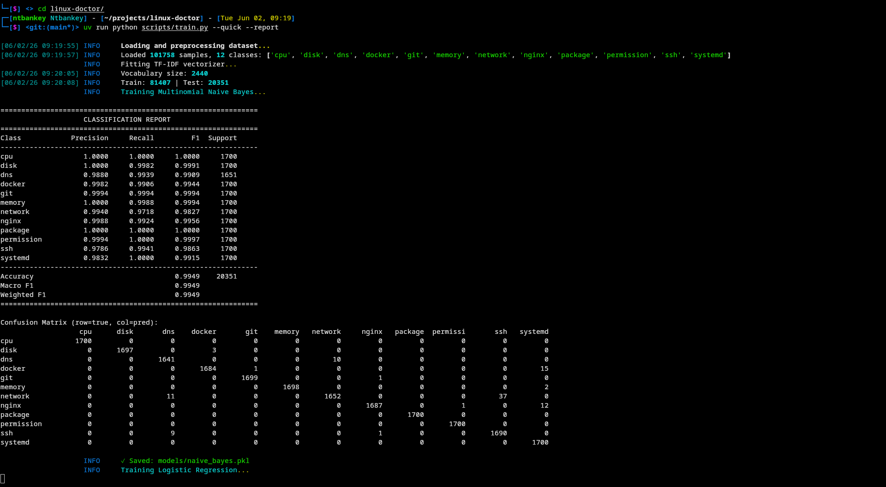
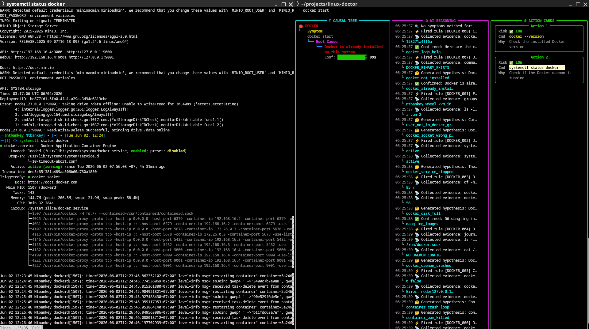
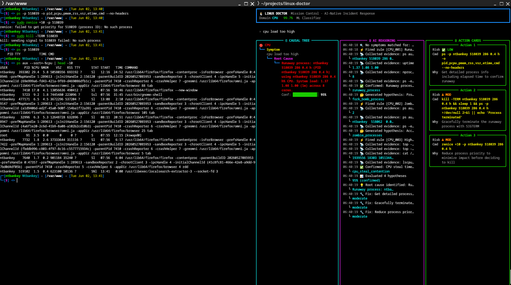
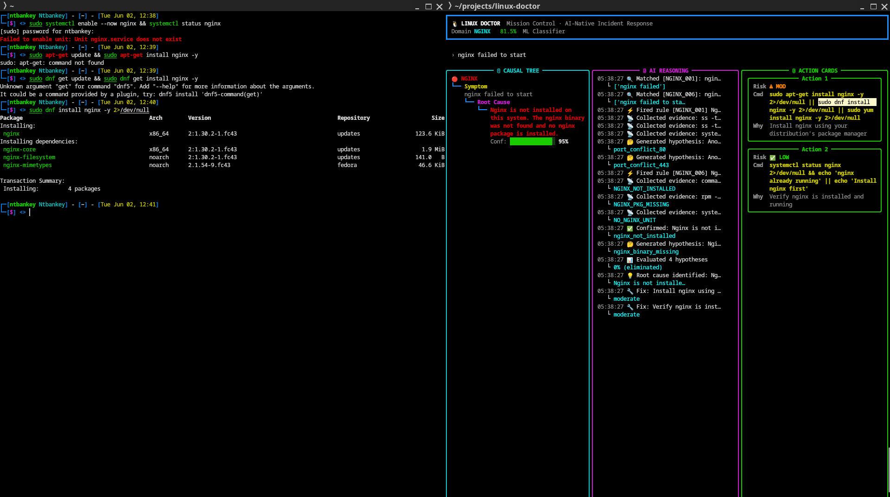

# 🐧 Linux Doctor — Hệ Thống Trí Tuệ Nhân Tạo Lai (Hybrid AI) Xử Lý Sự Cố


-orange)


> **Nhập bất kỳ sự cố Linux nào bằng ngôn ngữ tự nhiên — Linux Doctor sẽ tự động dự đoán miền sự cố (Domain), chẩn đoán nguyên nhân gốc rễ, giải thích logic suy luận và đề xuất các lệnh khắc phục an toàn thông qua giao diện điều khiển (Mission Control TUI).**

---

## 🌟 1. TỔNG QUAN DỰ ÁN (EXECUTIVE SUMMARY)

**Linux Doctor** là một hệ thống tự động hóa vận hành IT dành cho các kỹ sư SRE và Sysadmin. Dự án được thiết kế với kiến trúc **Hybrid AI (AI Lai)**, kết hợp giữa tốc độ nhận thức của Machine Learning và khả năng suy luận có kiểm chứng của Hệ thống Chuyên gia (Expert System).

Toàn bộ hệ thống được xây dựng hoàn toàn độc lập (from scratch), không phụ thuộc vào các framework nặng nề như PyTorch hay Scikit-Learn, giúp hệ thống cực kỳ nhẹ, bảo mật và dễ dàng audit.

---

## ⚙️ 2. KIẾN TRÚC HỆ THỐNG (SYSTEM ARCHITECTURE)

Hệ thống mô phỏng chính xác cách một kỹ sư Linux kỳ cựu tiếp cận và giải quyết vấn đề:

1. **Lớp Nhận Thức (Machine Learning):** Đọc log và ngay lập tức khoanh vùng vấn đề thuộc nhóm nào (Ví dụ: Docker, CPU, Network).
2. **Lớp Suy Luận (Expert System):** Khi đã biết nhóm lỗi, hệ thống tự động chạy các lệnh bash an toàn (như `groups`, `systemctl status`) để thu thập chứng cứ, sau đó dùng thuật toán Bayes để chấm điểm và tìm ra nguyên nhân gốc rễ.



---

## 🧠 3. HIỆU NĂNG MÔ HÌNH HỌC MÁY (ML PIPELINE)

Hệ thống Machine Learning được huấn luyện trên tập dữ liệu **101.758 mẫu** được phân bổ qua 12 domain sự cố Linux (Docker, CPU, Disk, Memory, Network, DNS, v.v.). Toàn bộ các thuật toán (TF-IDF, Naive Bayes, Logistic Regression, Linear SVM) đều được viết thủ công bằng **NumPy**.

> **Lưu ý về dữ liệu:** `data/raw/linux_issues.jsonl` là dữ liệu **tổng hợp (synthetic)**, được sinh từ các template trong `scripts/generate_dataset.py` (có mở rộng tổ hợp và song ngữ Anh–Việt). Các chỉ số bên dưới phản ánh tập kiểm thử có cùng phân phối tổng hợp, không đại diện cho độ chính xác trên log thực tế ngoài production.

### Kết quả của Multinomial Naive Bayes trên tập kiểm thử
*   **Weighted F1-Score: 99.49%** (theo `models/eval_report.json`)
*   **Chi tiết:** Mô hình Naive Bayes đạt kết quả cao trên dữ liệu văn bản và xử lý khá tốt các từ vựng gây nhiễu. Ma trận nhầm lẫn dưới đây cho thấy số lượng dự đoán sai rất thấp trên tập kiểm thử tổng hợp.



*(Hệ thống cũng đi kèm Logistic Regression — Weighted F1 96.86% — và Linear SVM — Weighted F1 99.23% — để dự phòng và tính toán xác suất tự tin).*

---

## 🔬 4. GIAO DIỆN CHUYÊN GIA (MISSION CONTROL TUI)

Hệ thống giao diện dòng lệnh không đơn thuần là in ra kết quả, mà là một bảng điều khiển tương tác. Nó hiển thị **Reasoning Chain (Chuỗi suy luận)** minh bạch để kỹ sư có thể tin tưởng vào AI.

Dưới đây là một số hình ảnh thực nghiệm hệ thống tự chẩn đoán sự cố:

### Khắc phục sự cố Docker (Phân quyền & Daemon)
Hệ thống nhận diện người dùng thiếu quyền (Permission) và đề xuất lệnh `usermod` để thêm người dùng vào nhóm docker.


### Khắc phục sự cố Quá Tải Hệ Thống (CPU/Memory)
Khi hệ thống bị treo do CPU Throttling hoặc Load Average cao, AI sẽ chạy các lệnh kiểm tra mức tiêu thụ tài nguyên và khoanh vùng tiến trình gây nghẽn.


### Khắc phục sự cố Định Tuyến & Máy Chủ (Network & Nginx)
AI kiểm tra bảng định tuyến, tường lửa (Firewall) và các file cấu hình Nginx để tìm ra lỗi sai cú pháp hoặc xung đột cổng (Bind Port).


> 👉 **ĐỂ XEM BÁO CÁO THỰC NGHIỆM CHI TIẾT NHẤT:** Vui lòng truy cập Sách trắng trực quan tại [**report_docs/BAO_CAO_CHI_TIET.md**](report_docs/BAO_CAO_CHI_TIET.md). Tài liệu này chứa toàn bộ 23 hình ảnh chứng minh năng lực của AI trên 11 Domain sự cố cốt lõi.

---

## 🚀 5. HƯỚNG DẪN CÀI ĐẶT NHANH (QUICK START)

Bạn có thể trải nghiệm Linux Doctor (bao gồm các model đã huấn luyện sẵn) thông qua vài lệnh đơn giản.

**Yêu cầu:** Python 3.13+ và [uv](https://docs.astral.sh/uv/). Installer tự động sẽ cài `uv` nếu chưa có.

**Cách 1: Cài đặt tự động (Linux/macOS)**
```bash
curl -fsSL https://raw.githubusercontent.com/NTbankey1/LinuxDoctor/main/scripts/install.sh | bash
```

**Cách 2: Cài đặt thủ công**
```bash
git clone https://github.com/NTbankey1/LinuxDoctor.git
cd LinuxDoctor
make setup
uv run linux-doctor "disk is full on /var"
```

---

## 🛠️ 6. NỢ KỸ THUẬT & LỘ TRÌNH PHÁT TRIỂN (ENGINEERING ROADMAP)

Thông qua quá trình kiểm toán kiến trúc, các hạng mục lớn đã và đang được triển khai như sau:

**Đã triển khai:**
1.  🛡️ **Bảo Mật:** `ShellRunner` dùng kiến trúc **Allowlist** kết hợp kiểm tra mẫu lệnh nguy hiểm và shell metacharacter, giảm thiểu rủi ro Command Injection.
2.  🗄️ **Lưu Trữ:** Trạng thái phiên và lịch sử sự cố được lưu trong **SQLite** (WAL mode) thay vì chỉ giữ trên RAM.

**Đang phát triển:**
3.  ⚡ **Hiệu Năng (P1):** Chuyển cơ chế thu thập bằng chứng từ chạy tuần tự sang chạy song song (**Parallel Execution**) để rút ngắn thời gian chẩn đoán.
4.  🧠 **Suy Luận (P2):** Áp dụng kiến trúc Backward Chaining để xác minh chéo nguyên nhân.

---

**Bản Quyền:** MIT License. Sử dụng tự do cho mục đích cá nhân, học thuật và thương mại.  
*Phát triển dành riêng cho cộng đồng kỹ sư Linux và những người đam mê AI.*
